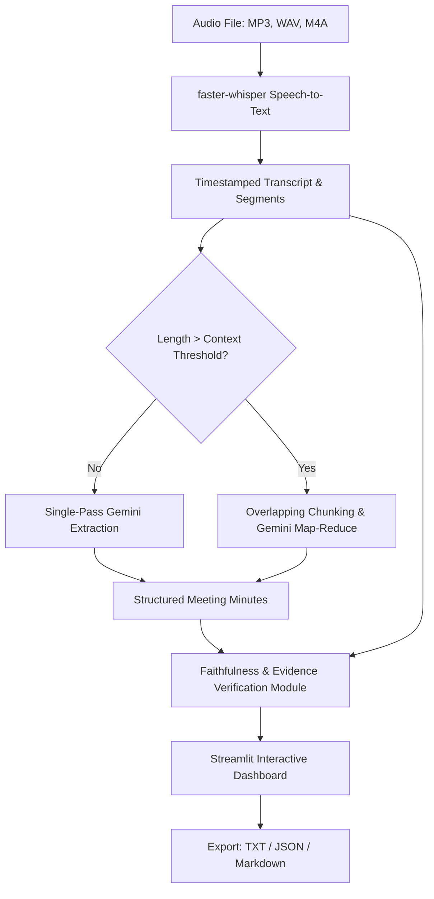

# 🎙️ AI Meeting Minutes Generator

An AI-powered web application built with **Python**, **Streamlit**, **faster-whisper**, and **Google Gemini** that transcribes meeting audio recordings (MP3, WAV, M4A) and generates structured, decision-grade meeting minutes with **strict transcript faithfulness verification**.

---

## 📌 Features

- **High-Speed Local Speech-to-Text**: Powered by `faster-whisper` (CTranslate2) with millisecond-accurate timestamped segments and voice activity detection (VAD).
- **Google Gemini LLM Intelligence**: Utilizes Google's Gemini models (`gemini-2.5-flash`, `gemini-2.0-flash`, `gemini-1.5-pro`) with native Pydantic structured output validation.
- **Faithful Structured Meeting Minutes**: Extracts 7 key elements without hallucination:
  1. **Meeting Summary** (High-level synthesis)
  2. **Key Decisions** (Explicitly agreed items only)
  3. **Action Items** (Concrete tasks)
  4. **Owners** (Explicitly named, or marked `"Not specified"`)
  5. **Deadlines** (Explicit timeframes, or marked `"Not specified"`)
  6. **Unresolved Questions** (Open debates, blockers)
  7. **Transcript Evidence** (Verbatim quotes with timestamp references)
- **Map-Reduce Long Transcript Chunking**: Automatically splits long transcripts into overlapping segment windows to handle meetings of any length without context truncation.
- **Faithfulness & Evidence Verification Engine**: Audits every action item against the original transcript:
  - 🟢 `SUPPORTED`: Fully grounded in spoken transcript.
  - 🟡 `PARTIALLY_SUPPORTED`: Discussed, but owner/deadline was weakly inferred.
  - 🔴 `UNSUPPORTED`: Hallucinated or contradicted by transcript.
- **Interactive Streamlit Dashboard**: Searchable timestamped transcript viewer, metrics cards, expandable verification drawer, and export to TXT, JSON, and Markdown.

---

## 🏗️ System Architecture



---

## 📁 Project Structure

```
meeting-minutes-generator/
├── app.py                  # Streamlit web application interface
├── transcription.py        # faster-whisper speech-to-text integration
├── minutes_generator.py    # Google Gemini LLM engine (Single-Pass & Map-Reduce)
├── evaluator.py            # Faithfulness and evidence verification engine
├── chunking.py             # Overlapping window segment chunker
├── models.py               # Pydantic schemas (Transcript, Minutes, ActionItem, etc.)
├── requirements.txt        # Python package dependencies
├── .env.example            # Environment variables template
├── README.md               # Setup and usage documentation
├── data/                   # Sample recordings and transcripts
│   ├── sample_meeting.wav  # Real spoken audio sample
│   └── sample_transcript.json
├── outputs/                # Directory for saved minutes exports
└── tests/
    ├── test_pipeline.py    # Automated unit and integration test suite
    └── verify_pipeline_e2e.py # End-to-end pipeline verification test
```

---

## 🚀 Getting Started

### 1. Prerequisites
- Python 3.10+ (tested on Python 3.10, 3.11, 3.12, 3.13)
- A [Google Gemini API Key](https://aistudio.google.com/app/apikey)

### 2. Installation

Clone or navigate to the repository directory:
```bash
cd meeting-minutes-generator
```

Create and activate a virtual environment (recommended):
```bash
# Windows
python -m venv venv
venv\Scripts\activate

# macOS / Linux
python3 -m venv venv
source venv/bin/activate
```

Install dependencies:
```bash
pip install -r requirements.txt
```

### 3. Environment Configuration

Copy the example environment file:
```bash
cp .env.example .env
```

Edit `.env` with your API key:
```env
GEMINI_API_KEY=your_gemini_api_key_here
GEMINI_MODEL=gemini-2.5-flash
WHISPER_MODEL=base
WHISPER_DEVICE=cpu
```
*(Note: You can also enter or override your Gemini API key directly within the Streamlit sidebar UI).*

---

## 🖥️ Running the Application

Launch the Streamlit web application:
```bash
python -m streamlit run app.py
```

Open your browser at `http://localhost:8501`.

### Main Workflow:
1. **Input Audio or Transcript**:
   - Upload any `.mp3`, `.wav`, or `.m4a` meeting recording, OR
   - Click **"Load Sample Meeting Recording"** in the sidebar for immediate testing.
2. **Configure Settings**:
   - Enter your Gemini API key in the sidebar.
   - Select your preferred Gemini model (`gemini-2.5-flash`, `gemini-2.0-flash`, `gemini-1.5-pro`).
   - Choose the Whisper model size (`tiny`, `base`, `small`, `medium`).
3. **Generate Minutes**:
   - Click **"🚀 Generate Meeting Minutes"**.
   - Watch the 3-step progress bar: Audio Transcription ➡️ Map-Reduce Gemini Analysis ➡️ Faithfulness Verification.
4. **Review & Audit**:
   - Inspect the **Meeting Minutes** tab (Summary, Decisions, Action Items with Owners & Deadlines).
   - Review the **Faithfulness Verification Report** to inspect verbatim evidence citations.
   - Explore the **Transcript Viewer** with segment search.
5. **Export**:
   - Download the verified minutes as **TXT**, **JSON**, or **Markdown**.

---

## 🛡️ Critical Faithfulness Guarantee

To eliminate hallucinations common in generic LLM summaries:
1. **Never Invented**: The prompt and schema forbid fabricating decisions, action items, owners, or deadlines.
2. **Explicit Fallbacks**: Any unmentioned owner or deadline is strictly marked `"Not specified"`.
3. **Transcript Evidence**: Every action item preserves the exact supporting spoken phrase and timestamp bracket.
4. **Automated Audit**: The evaluator module cross-examines every extracted action item against the original transcript, tagging items as `SUPPORTED`, `PARTIALLY_SUPPORTED`, or `UNSUPPORTED`.

---

## 🧪 Running Tests

Execute the automated test suite covering models, chunking, transcription, and verification:
```bash
python -m unittest tests/test_pipeline.py -v
```
All 12 unit and integration tests run in under 3 seconds.
